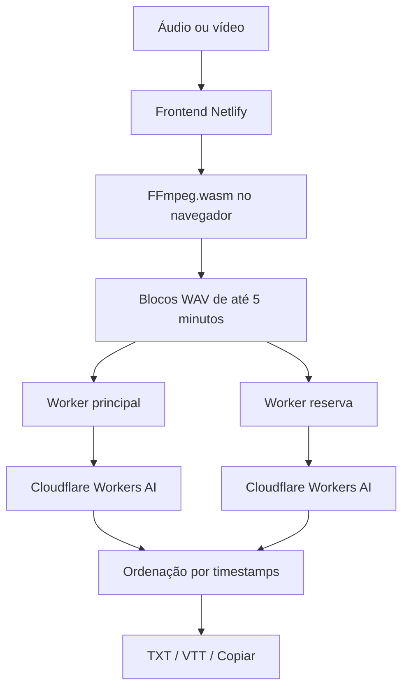

<h1 align="center">Transcritor de Aulas</h1>

<p align="center">
  Transcrição de áudios e vídeos com inteligência artificial, marcações de tempo e exportação de resultados.
</p>

<p align="center">
  <strong>HTML · CSS · JavaScript · FFmpeg.wasm · Whisper · Cloudflare Workers AI · Netlify</strong>
</p>

<p align="center">
  <strong>Aplicação web hospedada no Netlify</strong>
</p>

<!-- URL pública do site não confirmada. Substitua a linha abaixo pelo endereço exibido no painel do Netlify. -->

**Acesse o site:** endereço de produção a confirmar no painel do Netlify.

---

[Sobre](#sobre) · [Funcionalidades](#funcionalidades) · [Como usar](#como-usar) · [Arquitetura](#arquitetura) · [Configuração](#configuração) · [Deploy](#deploy-no-netlify) · [Segurança](#segurança-e-limitações)

## Sobre

O **Transcritor de Aulas** é uma aplicação web para transformar fala em texto, seja de uma aula inteira ou de um intervalo específico. O áudio é extraído no navegador e enviado em blocos a dois Cloudflare Workers, que realizam a transcrição com Whisper. O texto é organizado cronologicamente e pode ser copiado ou exportado.

O frontend é hospedado no **Netlify**. O GitHub é utilizado para versionamento e documentação do código-fonte e aciona o deploy automático no Netlify.

## Funcionalidades

| Recurso | Descrição |
| --- | --- |
| Origem da mídia | Seleção de arquivo, arrastar e soltar ou link direto compatível com o proxy. |
| Intervalos | Aula inteira ou somente trecho, com início e fim editáveis. A opção **Até o final** usa a duração real da mídia. |
| Horários | Digitação progressiva no formato `HH:MM:SS`, colagem de horários e ajuste automático do fim. |
| Idiomas | Detecção automática ou seleção manual de nove idiomas. |
| Processamento paralelo | Dois Workers processam blocos alternados de até cinco minutos. |
| Recuperação | Em erros recuperáveis, os blocos são divididos em partes de até dois minutos e, se necessário, em trechos menores. |
| Failover | Tentativa de encaminhar a transcrição ao outro Worker em caso de erro explícito de cota. |
| Resultados | Timestamps, cópia do texto e exportação TXT e VTT. |
| Interface | Tema claro/escuro, progresso e cancelamento. |

## Como usar

1. Abra o transcritor e selecione um arquivo de áudio ou vídeo, ou informe um link direto compatível.
2. Escolha o idioma do áudio. **Automático** é a primeira opção e o padrão quando não existe preferência salva.
3. Escolha **Aula inteira** ou **Somente trecho**.
4. Clique em **Transcrever** e acompanhe o progresso.
5. Copie o texto ou baixe o resultado em TXT ou VTT.

### Intervalos de transcrição

| Objetivo | Início | Fim |
| --- | --- | --- |
| Do começo até 15 minutos | `00:00:00` | `00:15:00` |
| Dos 15 aos 35 minutos | `00:15:00` | `00:35:00` |
| Dos 37 minutos até o fim | `00:37:00` | Marque **Até o final** |

Se o horário final informado exceder a duração real do vídeo, o sistema limita o intervalo automaticamente. Para começar do início, basta informar `00:00:00`.

Na digitação progressiva, os números entram pela direita: `1` → `00:00:01`, `12` → `00:00:12`, `123` → `00:01:23`. `Backspace` apaga o último dígito e `Delete` zera o horário.

### Idiomas

Automático, Português, Japonês, Inglês, Espanhol, Francês, Alemão, Italiano, Coreano e Chinês. A preferência é salva no navegador. A transcrição é realizada no idioma do áudio, não traduzida.

## Arquitetura



O FFmpeg extrai WAV mono PCM de 16 kHz no navegador. A extração é serializada em uma única instância do FFmpeg, enquanto até duas filas de transcrição podem operar em paralelo. A distribuição normal é aproximadamente equilibrada; retries, falhas e failover podem alterar esse equilíbrio.

Cada Worker utiliza `@cf/openai/whisper-large-v3-turbo` e, em alguns erros de decodificação, pode recorrer a `@cf/openai/whisper`. O resultado é ordenado por timestamp independentemente da ordem em que os pedidos terminam.

## Tecnologias

| Camada | Tecnologia |
| --- | --- |
| Interface | HTML, CSS, JavaScript |
| Processamento local | FFmpeg.wasm |
| Backend | Cloudflare Workers |
| Reconhecimento de fala | Cloudflare Workers AI / Whisper |
| Hospedagem | Netlify |
| Preparação do deploy | Python 3, sem dependências adicionais |
| Versionamento | Git e GitHub |

## Estrutura do projeto

```text
transcritor-aulas/
├── .env.example                 # Modelo de configuração pública
├── .gitignore                   # Arquivos locais e gerados ignorados
├── README.md
├── _headers                     # Cabeçalhos de isolamento do Netlify
├── app.js                       # Processamento e interface
├── favicon.svg
├── index.html
├── netlify.toml                 # Build e publicação automática
├── style.css
├── worker-principal.js          # Worker principal e failover
├── worker-reserva.js            # Worker reserva
└── scripts/
    └── preparar_netlify.py      # Geração do frontend publicável
```

## Configuração

### Cloudflare Workers

Para uma instalação nova, crie os dois Workers e publique os respectivos arquivos JavaScript. Configure o binding **Workers AI** com o nome `AI` em ambos. Mantenha a compatibilidade Node.js exigida pelo uso de `node:buffer` (flag `nodejs_compat`, quando necessária).

No Worker principal, em **Settings → Variables and secrets**, cadastre a variável de texto `BACKUP_WORKER_URL` com a URL HTTPS do Worker reserva. Essa variável permite o failover no backend.

Para verificar a publicação, abra a URL de cada Worker. O diagnóstico do principal deve indicar `"versao":"13.6-primary"` e `"backup_configurado":true`; o reserva deve indicar `"versao":"13.6-reserva"`. Essas respostas confirmam a versão e a presença da configuração, não um teste completo da transcrição.

### Variáveis do frontend

No Netlify, configure as duas variáveis na interface do projeto; o ambiente de build tem prioridade. Para desenvolvimento local, na raiz do repositório, crie `.env` a partir do modelo, caso ainda não exista:

```bash
cp .env.example .env
```

Preencha as URLs reais:

```dotenv
PRIMARY_WORKER_URL=https://seu-worker-principal.seu-subdominio.workers.dev/
BACKUP_WORKER_URL=https://seu-worker-reserva.seu-subdominio.workers.dev/
```

A variável `BACKUP_WORKER_URL` do frontend não substitui a variável de mesmo nome configurada no Worker principal. São configurações independentes.

## Deploy no Netlify

O deploy é automático a partir do repositório GitHub conectado ao Netlify. Não é necessário enviar arquivos manualmente a cada atualização.

### Configuração inicial

1. Conecte o repositório GitHub ao projeto existente no Netlify e selecione a branch `main` para produção.
2. Em **Project configuration → Environment variables**, cadastre `PRIMARY_WORKER_URL` e `BACKUP_WORKER_URL` com as URLs HTTPS dos respectivos Workers. As variáveis precisam estar disponíveis ao build de produção.
3. Mantenha o diretório base na raiz do repositório. O arquivo `netlify.toml` define o comando `python3 scripts/preparar_netlify.py` e o diretório de publicação `deploy-netlify`.
4. Faça um deploy pelo Netlify ou envie um commit à branch de produção.

O script gera `config.js` a partir das variáveis do ambiente de build. Para testar localmente, também é possível configurar `.env` e executar:

```bash
python3 scripts/preparar_netlify.py
```

A saída contém apenas os arquivos publicáveis:

```text
deploy-netlify/
├── _headers
├── app.js
├── config.js
├── favicon.svg
├── index.html
└── style.css
```

O arquivo `_headers` mantém os cabeçalhos COOP/COEP necessários ao FFmpeg.wasm. Após publicar, recarregue o site e teste uma transcrição curta. Os Workers só precisam de novo deploy quando seu próprio código ou configuração mudar.

## Segurança e limitações

- Mantenha `.env`, `config.js` e `deploy-netlify/` fora do Git. Versione apenas `.env.example` com valores de exemplo.
- As URLs dos Workers são públicas por natureza. `config.js` é enviado ao navegador e não deve conter tokens, senhas nem chaves privadas. Variáveis de ambiente não tornam os endpoints privados.
- O proxy aceita URLs HTTPS de mídia do domínio `cdn.estrategiaconcursos.com.br`. Links assinados podem expirar.
- O backend rejeita blocos WAV acima de 20 MB. O processamento depende da memória, da CPU do dispositivo, da conexão e das cotas dos serviços.
- O failover não garante disponibilidade. Respeite os limites e termos dos provedores e considere controles de acesso e de requisições para proteger os endpoints públicos.
- O cancelamento interrompe a execução local e os pedidos do navegador; uma inferência já iniciada no servidor pode continuar.
- A qualidade da transcrição depende do áudio, do idioma e do modelo.

## Manutenção

Para versionar uma alteração de frontend, revise `git status`, adicione somente os arquivos alterados e envie o commit ao GitHub. Não publique o `.env` ou a saída gerada. O push na branch de produção aciona o build e o deploy automático no Netlify.

O projeto mantém os nomes estáveis `worker-principal.js` e `worker-reserva.js`; versões anteriores permanecem no histórico do Git.
